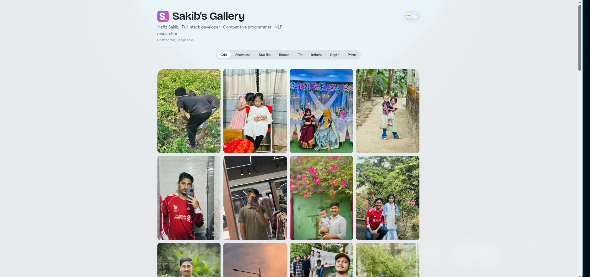

<div align="center">


# Sakib's Gallery

**A fast, installable photo gallery with 8 hand-tuned viewing styles, day/night theme and zero backend.**
Drop in photos, run one command, and publish up to ~500 pictures on Vercel for free.


</div>

---

## Screenshots



> The style switcher sits at the top of the page, and the choice is remembered between visits.

---

## Table of contents

1. [Features](#features)
2. [Gallery styles](#gallery-styles)
3. [Quick start](#quick-start)
4. [Adding and managing photos](#adding-and-managing-photos)
5. [Project structure](#project-structure)
6. [Configuration](#configuration)
7. [Adding or removing a style](#adding-or-removing-a-style)
8. [Theme and fonts](#theme-and-fonts)
9. [PWA and offline support](#pwa-and-offline-support)
10. [Deploying to Vercel](#deploying-to-vercel)
11. [Scripts reference](#scripts-reference)
12. [Troubleshooting](#troubleshooting)
13. [Tech stack](#tech-stack)
14. [Author](#author)

---

## Features

- **Random order**: photos are shuffled on every page load and every time you switch style, in every style.
- **Every style shows every photo**: no style is limited to a sample, so all your pictures (400+) appear everywhere.
- **Clean look**: no titles, file names or captions are shown anywhere, only the pictures.
- **8 gallery styles** in one page: Grid, Showcase, Duo flip, Ribbon, Tilt, Infinite, Depth and Prism.
- **Automatic photo pipeline**: HEIC support, auto-rotate, EXIF/GPS stripping, three WebP sizes, renamed oldest to newest by capture date.
- **Scales to ~500 photos** with no database. The photo list is a tiny JSON file (about 12 KB of JS in total). Heavy styles load pictures only when they are about to be seen (Duo flip keeps just a few on the GPU, Ribbon and Infinite reuse a small set of cards, Tilt loads by distance).
- **Full-size lightbox** for Grid and Showcase, with keyboard and swipe navigation.
- **Day / night theme** with a circular reveal animation. The choice is remembered.
- **Installable PWA** with an **Install** button in the header (one click opens the browser install dialog, with a short how-to on browsers that have none, like iPhone Safari), for Android, desktop and iOS, with a service worker that caches the app shell and every photo you open.
- **Code-split styles**: three.js, GSAP and Motion Brew are downloaded only when a style that needs them is opened.
- **Privacy-friendly**: GPS and EXIF metadata are removed from every published image.
- **Vercel-ready** with long-lived immutable caching headers for images and assets.

## Gallery styles

| Style | What it does | Photos shown | Opens in lightbox |
| --- | --- | :---: | :---: |
| **Grid** | Responsive masonry grid (the default style) | all | yes |
| **Showcase** | Large featured layout with a thumbnail strip | all | yes |
| **Duo flip** | WebGL liquid-glass page turn. Click, drag or use the arrow keys. Every picture is shown **in full**, never cropped | all | no |
| **Ribbon** | Tilted ribbon of cards you can scroll through | all | no |
| **Tilt** | 3D tilt carousel | all | no |
| **Infinite** | Endless drifting wall of photos. A card gets the next photo each time it wraps around | all | no |
| **Depth** | Depth-of-field carousel | all | no |
| **Prism** | Rotating prism of cards | all | no |

Every style gets the same photo list in a fresh random order, so no photo is ever left out. The animated styles stay smooth with hundreds of photos because they never hold all of them in memory at once.

### About Duo flip

Textures are created lazily: only the current picture and a few neighbours stay on the GPU, so 400+ photos cost the same as 10.

Duo flip is a local copy of the `DuoFlip` component from [Motion Brew](https://motion-brew.com) (MIT) in `src/components/duo-flip.jsx`. The original crops every picture to fill its card. This copy draws the **whole picture** (contain) and fills any leftover space with a soft, dimmed, blurred copy of the same photo, so portrait and landscape shots both look right.

---

## Quick start

Requirements: **Node.js 18+** and npm.

```bash
# 1. install dependencies
npm install

# 2. put your photos in the photos/ folder (any format, HEIC included)

# 3. start the dev server (also watches photos/ for new files)
npm run dev          # http://localhost:5173

# 4. production build (output in dist/)
npm run build
npm run preview      # preview the production build locally
```

---

## Adding and managing photos

1. Drop photos into **`photos/`** at the project root, next to `package.json`. Photos pasted into `public/gallery/` by mistake are picked up too.
2. Run `npm run dev` and leave it running. It starts the site **and** watches `photos/`, so photos added later are processed automatically and the page reloads.
3. Commit the generated files and push:

```bash
git add public/gallery src/gallery-meta.json scripts/gallery-state.json
git commit -m "Add new photos"
git push
```

What `scripts/prepare-gallery.mjs` does for every photo:

| Step | Result |
| --- | --- |
| Decode | HEIC/HEIF converted in memory (capture date is read first, because conversion drops EXIF) |
| Process | Auto-rotated, resized, converted to WebP, GPS/EXIF stripped |
| Sizes | `N.webp` (1600 px), `N-medium.webp` (900 px), `N-thumb.webp` (400 px) |
| Rename | All photos (old and new) numbered `1, 2, 3 ...` from oldest to newest by EXIF date, else file modified time |
| Backup | Untouched originals are moved to `originals/` (git-ignored) |
| Report | Prints the total size. Keep it under about 95 MB (Vercel Hobby lists a 100 MB static-upload limit) |

Useful notes:

- **Delete a photo** by deleting `public/gallery/N.webp`. The `-medium` and `-thumb` files are cleaned up and the next run renumbers everything.
- **Change sizes or quality** by editing `TIERS` in `scripts/prepare-gallery.mjs`, then run `npm run gallery:rebuild`.
- `photos/` and `originals/` are git-ignored. On Vercel/CI the prepare step is skipped and what you committed is deployed.

---

## Project structure

```bash
gallery-site/
├── docs/
│   └── screenshots/              # images used in this README
│       └── gallery.png
├── photos/                       # DROP YOUR PHOTOS HERE (git-ignored, emptied after processing)
│   └── PUT_PHOTOS_HERE.txt
├── originals/                    # untouched backups of processed photos (git-ignored, auto-created)
├── public/                       # static files served as-is
│   ├── gallery/                  # generated images: N.webp, N-medium.webp, N-thumb.webp (committed)
│   ├── icons/                    # PWA icons (192, 512, maskable 512)
│   ├── favicon.svg
│   ├── favicon.ico
│   ├── favicon-32.png
│   ├── apple-touch-icon.png
│   ├── manifest.webmanifest      # PWA manifest
│   └── sw.js                     # service worker (bump VERSION to reset caches)
├── scripts/
│   ├── dev.mjs                   # `npm run dev`: Vite + photo watcher
│   ├── prepare-gallery.mjs       # photo pipeline (convert, resize, rename, write metadata)
│   └── gallery-state.json        # generated: dates and hashes used for renaming (committed)
├── src/
│   ├── components/
│   │   ├── Grid.jsx              # Grid style
│   │   ├── Showcase.jsx          # Showcase style
│   │   ├── duo-flip.jsx          # Duo flip style (WebGL, shows full pictures)
│   │   ├── RibbonGallery.jsx     # Ribbon style
│   │   ├── tilt-carousel.jsx     # Tilt style
│   │   ├── infinite-gallery.jsx  # Infinite style (local copy that cycles through every photo)
│   │   ├── InstallButton.jsx     # "Install" button (PWA)
│   │   ├── Lightbox.jsx          # full-size viewer for Grid and Showcase
│   │   ├── ThemeToggle.jsx       # sun / moon switch
│   │   └── icons.jsx             # social and UI icons
│   ├── App.jsx                   # page layout, random shuffle, style switcher and the STYLES list
│   ├── gallery.js                # builds the photo list from gallery-meta.json (no titles or captions)
│   ├── gallery-meta.json         # generated: [[originalName, width, height, version], ...]
│   ├── site.js                   # your name, bio and social links
│   ├── pwa.js                    # captures the browser install prompt for the Install button
│   ├── theme.js                  # day / night logic with circular reveal
│   ├── index.css                 # Tailwind, theme tokens, view-transition rules
│   └── main.jsx                  # app entry and service worker registration
├── index.html                    # HTML shell, meta tags, PWA links
├── vite.config.js                # Vite + React + Tailwind 4, "@" alias for src/
├── vercel.json                   # cache headers for gallery, assets and service worker
├── package.json
├── package-lock.json
├── .gitignore
└── README.md
```

---

## Configuration

### Your info: `src/site.js`

| Field | Used for |
| --- | --- |
| `title` | Header, browser tab and installed app name |
| `name`, `full`, `tagline`, `place`, `bio` | Header and footer text |
| `email` | Contact details |
| `social` | Footer icon links (GitHub, LinkedIn, Codeforces, LeetCode, X, Instagram, Facebook, WhatsApp) |

### Page title and PWA name

Set the same title in `index.html`, `public/manifest.webmanifest` and `site.title` in `src/site.js`.

### How many photos each style shows

All of them. There is no limit to configure: every style gets the full list, shuffled (see `shuffle` in `src/App.jsx`).

---

## Adding or removing a style

All styles live in the `STYLES` array in `src/App.jsx`. One entry is one style:

```jsx
{ id: "grid", name: "Grid", lightbox: true, render: (p) => <Grid {...p} /> },
```

| Option | Meaning |
| --- | --- |
| `id` | Unique key, also saved in `localStorage` |
| `name` | Label in the switcher |
| `lightbox: true` | Clicking a picture opens the full-size viewer |
| `frame: true` | Draws the rounded bordered card around the style |
| `render` | Receives `{ items, onOpen, dark, w }` and returns the component |

- **Remove a style**: delete its entry (and its lazy import at the top of `App.jsx` if it has one). A visitor who had the removed style saved simply falls back to the first style.
- **Add a style**: create or import the component, add one entry to `STYLES`.

---

## Theme and fonts

- Day mode is the default. The sun/moon switch in the top right flips to night with a circular reveal and remembers the choice (`src/theme.js`).
- Colors are CSS variables (`--ink`, `--mist`, `--surface`) defined in `src/index.css`. Edit them to re-theme the whole site.
- Fonts: **Bricolage Grotesque** (headings) and **Figtree** (text), self-hosted through `@fontsource-variable`, so no external font requests.

---

## PWA and offline support

- Tap the **Install** button in the header: on Android and desktop (Chrome/Edge) it opens the install dialog straight away. On iOS Safari there is no install dialog, so the button shows the manual steps (Share, then Add to Home Screen). The button disappears once the app is installed.
- `public/sw.js` caches the app shell and every photo you open, so repeat visits and offline use are fast.
- The service worker is registered only in production (`npm run build` / Vercel), not in `npm run dev`.
- Bump `VERSION` in `public/sw.js` to make every visitor drop the old caches.

---

## Deploying to Vercel

1. Process your photos locally and commit `public/gallery`, `src/gallery-meta.json` and `scripts/gallery-state.json`.
2. Push the repository to GitHub.
3. Import the repository in Vercel. Vercel detects Vite automatically:
   - Build command: `npm run build`
   - Output directory: `dist`
4. `vercel.json` already sets long-lived `immutable` caching for `/gallery/*` and `/assets/*`, and revalidation for `sw.js` and the manifest.

Keep the total size of `public/gallery` under about 95 MB on the Hobby plan.

---

## Scripts reference

| Command | What it does |
| --- | --- |
| `npm run dev` | Starts Vite, processes `photos/` and keeps watching it. Extra flags work, e.g. `npm run dev -- --host` |
| `npm run build` | Processes photos (skipped on Vercel/CI), then builds to `dist/` |
| `npm run preview` | Serves the production build locally |
| `npm run photos` / `npm run convert` | Processes `photos/` once, without starting the dev server |
| `npm run gallery:rebuild` | Re-processes everything in `originals/` (use after changing `TIERS`) |

---

## Troubleshooting

| Problem | Fix |
| --- | --- |
| Page says "No images yet" | Put photos in `photos/` and run `npm run dev` |
| `sharp is not installed` | Run `npm install` |
| New photos do not show up | Keep `npm run dev` running, wait a few seconds after the copy finishes, or run `npm run photos` |
| Old pictures after an update | Hard refresh, or bump `VERSION` in `public/sw.js` |
| Duo flip shows the plain picture without the fold effect | The browser has no WebGL. It falls back to a simple fade and still shows the full picture |
| Build is too large for Vercel Hobby | Lower the `width` or `quality` in `TIERS`, then run `npm run gallery:rebuild` |

---

## Tech stack

- [React 18](https://react.dev) and [Vite 6](https://vite.dev)
- [Tailwind CSS 4](https://tailwindcss.com) with `@tailwindcss/vite`
- [Motion Brew](https://motion-brew.com), [Motion](https://motion.dev) / Framer Motion, [GSAP](https://gsap.com) and [three.js](https://threejs.org)
- [sharp](https://sharp.pixelplumbing.com), [heic-convert](https://github.com/catdad-experiments/heic-convert) and [exifr](https://github.com/MikeKovarik/exifr) for the photo pipeline
- [react-icons](https://react-icons.github.io/react-icons/) and `@fontsource-variable` fonts

---

## Author

**Hafiz Sakib** (Mohammad Hafizur Rahman Sakib), full-stack developer, competitive programmer and NLP researcher from Chattogram, Bangladesh.

- GitHub: [Hafiz-Sakib](https://github.com/Hafiz-Sakib)
- Portfolio: [hafizsakib.vercel.app](https://hafizsakib.vercel.app)

All rights reserved. The Duo flip component is derived from Motion Brew (MIT licensed).
